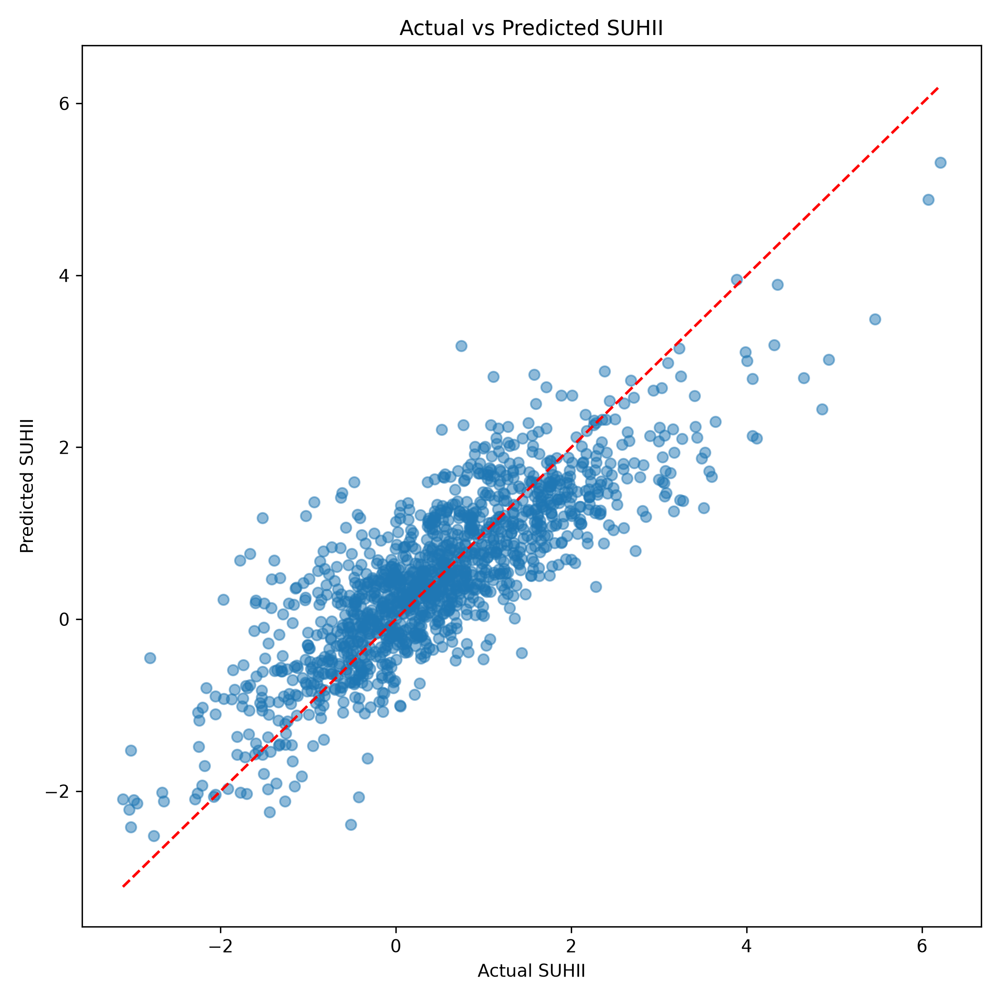

<div align="center">

# Delhi Urban Heat Digital Twin

### See where Delhi heats up. Compare spatial models. Explore what-if scenarios.

Satellite observations → 1 km heat indicators → spatial machine learning → interactive scenario explorer


[Explore the simulation](#try-the-scenario-explorer) · [See model results](#results-at-a-glance) · [Browse the code](#repository-map)

</div>

---

## The question

**Can satellite data help us understand how heat varies across Delhi, and what changes a trained model predicts when local environmental indicators are adjusted?**

We estimate **surface urban heat island intensity (SUHII)**: a location's land-surface temperature relative to a local rural reference, measured in °C. The project brings together historical imagery, spatial validation, model comparisons and an interactive scenario explorer. It is a planning and research tool for *surface heat*, not a live weather forecast.

## What you can do here

| Explore | What it gives you |
| --- | --- |
| **Map heat-related observations** | Delhi data for 2024–2026, aggregated into 1 km cells |
| **Inspect model evidence** | Saved predictions, fold metrics and comparisons across RF, GB, XGBoost and LightGBM |
| **Test predictor scenarios** | Change NDVI, NDBI, albedo or Dynamic World built/tree probabilities and see predicted SUHII differences |
| **Reproduce the workflow** | Data pipeline, preprocessing decisions, notebooks, training scripts and saved evaluation outputs |


**Data sources:** Landsat 8/9, VIIRS night lights, GPW population, Sentinel-5P atmospheric products, CHIRPS rainfall and Dynamic World land-cover probabilities. See the [architecture](docs/UHI_Final_System_Architecture.md) and [data decisions](docs/DECISIONS.md).

## Results at a glance

### Saved spatial test comparison

| Configuration | RMSE ↓ | MAE ↓ | R² ↑ |
| --- | ---: | ---: | ---: |
| Reference XGBoost | 0.689 °C | 0.526 °C | 0.675 |
| **XGBoost + 3 km neighbourhood** | **0.618 °C** | **0.475 °C** | **0.739** |

Across **1,350 test rows**, neighbourhood context reduced RMSE by about **10.3%** compared with this reference configuration. [View the saved test results](models/final_evaluation/20261114_231907_965985/test_summary.csv). This test area had been evaluated in earlier project work; it should not be described as a previously unseen final holdout.

### Research comparison: does spatial context help?

In a separate **development cross-validation** experiment, adding neighbourhood context and local contrast improved all four model families against their respective cell-only baselines. The best mean fold RMSE in that experiment was **0.609 °C for XGBoost with context + contrast** (R² **0.751**). These are development scores, **not** the test scores above or a model already deployed in the simulation. [Full model comparison](models/experiments/novelty_benchmark_20261117_111010_101180/summary.csv) · [Feature ablation](models/experiments/novelty_benchmark_20261117_111010_101180/paired_ablation.csv)

<details>
<summary><strong>See an actual diagnostic plot</strong></summary>

Random Forest baseline: observed versus predicted SUHII. This is a diagnostic for the RF model, **not** a plot of the XGBoost results above.



[More RF diagnostics](models/rf_analysis/)

</details>

## Try the scenario explorer

The [Streamlit app](simulation/app.py) lets you select a **historical year and Delhi cell**, edit environmental predictors and compare **baseline versus scenario predicted SUHII**. It also shows study-cell locations and exports a result CSV plus scenario settings JSON.

```bash
# Run from the repository root with Python 3.10+
python -m venv .venv
# Activate .venv for your shell
python -m pip install -r requirements.txt
python -m pip install streamlit
python -m streamlit run simulation/app.py
```

The app uses the saved **3 km neighbourhood XGBoost** model and checks that baseline predictions match saved evaluation output before displaying scenarios. A negative scenario difference means lower *predicted* SUHII. Dynamic World values are class probabilities, not verified land-area shares; changing a predictor does not establish a real intervention's causal cooling effect. [Read the scenario engine](simulation/engine.py) · [Read its checks](simulation/test_engine.py).

## Repository map

| Start here | Purpose |
| --- | --- |
| [`simulation/`](simulation/) | Interactive explorer and prediction engine |
| [`models/final_evaluation/`](models/final_evaluation/) | Saved spatial test metrics, predictions and model bundles |
| [`models/experiments/`](models/experiments/) | Spatial fold comparisons and feature ablations |
| [`notebooks/`](notebooks/) | Preprocessing and modelling walkthroughs |
| [`scripts/`](scripts/) | Data export, preparation and model experiments |
| [`src/uhi/`](src/uhi/) | Earth Engine and preprocessing code |
| [`data/`](data/) | Delhi source and processed data |
| [`configs/`](configs/) | City and pipeline configuration |
| [`docs/`](docs/) | Architecture, specification and research decisions |

### Reproduce the data pipeline

The repository already includes Delhi observations and saved model results. New Earth Engine exports require authentication and `export.gee_project` in [`configs/pipeline.yaml`](configs/pipeline.yaml).

```bash
python -m pip install -e ".[gee,geo,parquet,notebook,dev]"
python -m pytest -q
earthengine authenticate
python scripts/01_export_gee.py --preflight-only
python scripts/01_export_gee.py
python scripts/02_fetch_gee.py
python scripts/03_preprocess.py
```

For the modelling trail, start with the [preprocessing review](notebooks/01_preprocessing_review.ipynb), [saved test comparison script](scripts/20_final_test_comparison.py) and [novelty benchmark](scripts/24_novelty_benchmark.py). Review script settings before rerunning experiments.

---

<sub><strong>Interpretation:</strong> These are satellite-derived land-surface estimates, not air-temperature measurements. The 2026 observation window is shorter than the prior full years. Model responses to edited predictors are sensitivity analyses, not validated cooling effects or future forecasts. See [assumptions and leakage controls](docs/DECISIONS.md).</sub>
